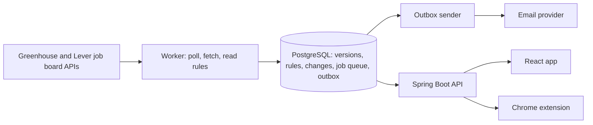

# FinePrint

FinePrint reads a job posting's title, description and application form and checks four eligibility rules against
a student's graduation month and degree: the graduation window, the degree level, whether they must return to
school after an internship, and what the posting says about visa sponsorship. Every answer quotes the sentence or
form question it came from. Saved postings are re-checked every hour, and a rule change or a closed posting sends
one email.

Project page with a live demo: https://itsmeck24.github.io/fineprint/

## What it does

- Paste a Greenhouse or Lever job link, or open the job page with the browser extension, and get a card:
  matches you, rules you out, asked on the form, or not stated, with the quote behind each one.
- Missing sponsorship text stays "not stated". It is never read as "no restriction".
- Each saved posting keeps every version. A new version only counts as a change when its rules change, so new
  wording alone does not send an email.
- A posting is called closed only after two 404s an hour apart while it is also missing from its board listing.
  Timeouts and server errors mark it unreachable and retry.
- Watch a company and get an hourly digest of new postings that do not rule you out.
- The only things stored about a user are an email, a password hash, a graduation month and a degree level.

## How it works



- **Job queue in Postgres.** Workers claim jobs with `FOR UPDATE SKIP LOCKED` and a lease. A worker that dies
  loses its lease and another worker takes the job. Every job is safe to run twice.
- **Rate limit shared through the database.** One request per host every two seconds across all workers, and every
  request is logged.
- **Versions and extraction in one transaction.** Saving a new version queues its extraction in the same
  transaction. Extraction compares the rules of a version with both neighbouring versions, so versions extracted out
  of order still report each change once.
- **Outbox.** A change and one notification per user who saved the posting are written in one transaction. The sender
  claims a notification with a lease and sends it with an idempotency key. If a send was cut off more than 23 hours
  ago, the provider no longer remembers the key, so the notification is marked `delivery_unknown` instead of being
  sent again. This is at-least-once delivery with deduplication, not exactly-once.
- **Extraction.** Keyword and date rules read the title, the text and the form. A local model (qwen3:14b through
  Ollama) can pick the sentence instead. Its quote must appear word for word in the posting and must be able to
  support the field, or it is dropped. The model never sees the form and has no tools.

## Results

All numbers come from runs saved in [`results/`](results), each with its command and commit.

### Extraction, on postings from companies not used to write the rules

108 postings from 13 companies. Labels were written from each posting's text and form and committed before anything
was scored ([labels](eval/labels/test.jsonl)). Cards are scored for a May 2027 graduate at each degree level, which
gives 177 cases where a stated rule rules the student out.

| | Graduation window F1 | Degree F1 | Card accuracy | Said "matches you" when ruled out |
| --- | --- | --- | --- | --- |
| Title only | not found | 0.70 | 0.65 | 1 of 177 |
| Rules | 0.83 | 0.88 | 0.92 | 0 of 177 |
| Local model | 0.79 | 0.90 | 0.94 | 1 of 177 |
| Model picks the sentence, rules read it | 0.84 | 0.88 | 0.95 | 1 of 177 |

Source: [eval-test-20261115-235727.json](results/eval-test-20261115-235727.json). The model ran three times (once at
temperature 0, twice at 0.3); no score moved by more than 0.005. Median 13.6 s per posting on an M4 Pro laptop.

- 97 of the 108 descriptions say nothing about sponsorship. Reading the form turns 86 of those from "not stated"
  into "asked on the form".
- Reading these results turned up rule bugs: "visa sponsorship is not available" was read as sponsoring, and a
  required bachelor's degree was read as excluding master's students. After the fixes the rules reach 0.97 card
  accuracy with 0 false "matches you" on the same postings
  ([eval-test-20261116-001153.json](results/eval-test-20261116-001153.json)). That number is not from unseen data.

### Change detection

Edits planted into copies of the 108 test postings, checked with the code the worker runs
([change-detection-20261115-223932.json](results/change-detection-20261115-223932.json)):

- 324 of 324 wording-only edits (a new sentence, a benefit line, a pay change) were ignored.
- 101 of 101 added "unable to sponsor" sentences were caught.
- 25 of 31 moved graduation years were caught. The 6 misses are postings whose window the rules did not read in the
  first place.

### Crash recovery

A harness runs two real worker processes against a fake job board and a fake email provider, keeps changing every
posting's rules, kills a random worker with `kill -9` every 1 to 4 seconds, and counts everything from the database.

| Run | Kills (mid-job) | Changes recorded | Emails sent | Resent after a kill | Duplicate emails |
| --- | --- | --- | --- | --- | --- |
| [507c223](results/crash-100-kills-20261115-200451.json) | 100 (99) | 2120 of 2120 | 4240 of 4240 | 93 | 0 |
| [721d557](results/crash-500-kills-20261115-223927.json) | 500 (214) | 2199 of 2200 | 4398 of 4398 | 159 | 0 |
| [31e9031](results/crash-500-kills-20261115-230536.json) | 500 (453) | 5840 of 5860 | 11680 of 11680 | 424 | 0 |
| [3693e92](results/crash-500-kills-20261115-233352.json) | 500 (450) | 5840 of 5860 | 11680 of 11680 | 415 | 0 |
| [f266a41](results/crash-500-kills-20261115-235704.json) | 500 (446) | 10700 of 10700 | 18739 of 21400 | 417 | 0 |
| [f5411ae](results/crash-500-kills-20261116-002923.json) | 500 (355) | 11920 of 11920 | 23840 of 23840 | 896 | 0 |

Every run is kept, including the ones that failed:

- **721d557** found a real bug. When a listing showed a new version while a fetch for that posting was already running,
  the poll stored the new `updated_at` anyway, so that version was skipped until the daily refresh. Fixed in 31e9031
  with a regression test.
- **31e9031 and 3693e92** both came up 20 short at the same generation. The diagnostics added for the second one showed
  no pending, missing or unextracted work: the harness had written graduation years past 2099, which the date rules do
  not read, so its expected count was wrong. Fixed in the harness in f266a41.
- **f266a41** recorded every change, but 2661 emails were still queued when the harness stopped waiting: one sender
  thread per process could not keep up. Senders run on several threads since f5411ae.
- **f5411ae** is the clean run: every change recorded and every email sent once.

"Resent after a kill" counts messages that reached the provider twice because a worker died between sending
and recording. The idempotency key made the provider drop every repeat.

### Throughput

One worker process against a fake board that answers every request after 100 ms, 400 postings, each a fetch job and
an extract job, host rate limit off, five runs per setting
([throughput-20261116-010920.json](results/throughput-20261116-010920.json)):

| Worker threads | Postings per second | sd |
| --- | --- | --- |
| 1 | 8.5 | 0.0 |
| 2 | 16.9 | 0.0 |
| 4 | 33.1 | 0.2 |
| 8 | 64.8 | 0.2 |

With one thread the board alone allows 10 per second, so claiming two jobs, reading the rules and writing the version
take about 18 ms per posting, and 8 threads get 7.6 times the speed of one. Against real boards the limit is the
2-second gap per host, not the queue.

## Run it

Needs Docker.

```
docker compose up -d --build
```

- App: http://localhost:8081
- API: http://localhost:8080
- Email inbox (Mailpit): http://localhost:8025

The worker polls the boards listed in `backend/src/main/resources/application.yml` once an hour.

Browser extension: `cd web && npm ci && npm run build:extension`, then load `web/dist-extension` as an unpacked
extension in Chrome and sign in from its options page.

### Hosting

`render.yaml` is a Render Blueprint. The root `Dockerfile` builds the React app into the Spring Boot jar, so one
web service serves the app, the API, the worker and the hourly collector, next to a Render Postgres database.
It fits the free plan: a local container capped at 512 MB and 0.1 CPU used about 200 MB. The free plan has limits:

- the service sleeps after 15 minutes idle, so the first visit takes about a minute;
- a free Postgres database is deleted after 30 days unless it is upgraded;
- mail is set to `log`, so alerts show on the Watching page instead of being emailed. Set
  `FINEPRINT_MAIL_PROVIDER=resend` with a key and a verified sender to email them.

The project page in `docs/` is a static build served by GitHub Pages.

## Tests

- `cd backend && ./mvnw verify`: 83 tests. Database tests run against real Postgres through Testcontainers. Job board
  and email provider calls go to local fake servers.
- End to end, against the full stack with a fake job board:
  ```
  docker compose -f docker-compose.yml -f docker-compose.e2e.yml up -d --build
  cd web && npm ci && npm run build && npx playwright install chromium && npx playwright test
  ```
  Covers saving a posting, the card, changing the profile, account deletion, and the extension on a job page.
- Crash run: `cd backend && ./mvnw test -Pcrash -Dtest=CrashHarnessTest -Dcrash.kills=500`
- Throughput: `cd backend && ./mvnw test -Pcrash -Dtest=ThroughputBenchTest`

## Reproduce the evaluation

```
docker compose up -d                                   # collector fills the database
python3 eval/export.py                                 # eval/data/dev.jsonl and test.jsonl (not committed)
cd backend
./mvnw test -Peval -Dtest=EvalRunnerTest -Deval.split=test -Deval.temperature=0 -Deval.seed=1
cd .. && python3 eval/score.py test
```

The model step needs Ollama with `qwen3:14b`. Postings change over time, so a new export will not match the committed
labels exactly; each label records the content hash of the version it was written from.

## Data and licenses

- Posting data comes from the public [Greenhouse Job Board API](https://developers.greenhouse.io/job-board.html) and
  [Lever Postings API](https://github.com/lever/postings-api), both documented for building job sites. Posting text
  is not redistributed; labels and the demo keep short quotes with links to the originals.
- Spring Boot, Flyway and Playwright are Apache 2.0. React, Vite, jsoup, Testcontainers and Ollama are MIT. PostgreSQL
  uses the PostgreSQL License. qwen3 is Apache 2.0.
- FinePrint itself is MIT licensed.

## Roadmap

- More job boards (Ashby, Workday).
- Rule versions stored with each extraction, so a rule update never looks like a posting change.
- Hosted deployment.
