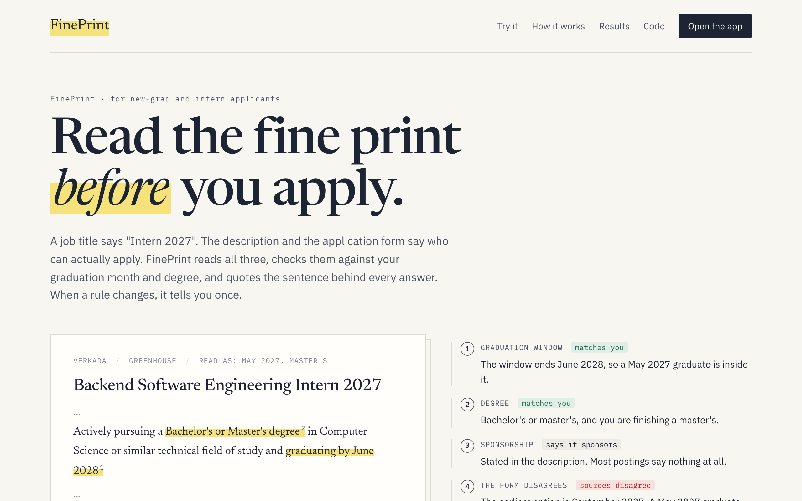
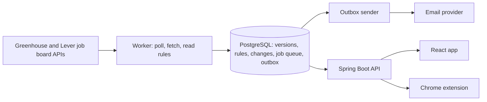

# FinePrint

[](https://github.com/itsmeck24/fineprint/actions/workflows/ci.yml)

FinePrint reads a job posting's title, description and application form and checks four eligibility rules against
a student's graduation month and degree: the graduation window, the degree level, whether they must return to
school after an internship, and what the posting says about visa sponsorship. Every answer quotes the sentence or
form question it came from. Saved postings are re-checked every hour, and a rule change or a closed posting sends
one email.

- Project page with a live demo: https://itsmeck24.github.io/fineprint/
- The app: https://fineprint-app.onrender.com (free server, the first visit takes about a minute to wake it)

[](https://itsmeck24.github.io/fineprint/)

## What it does

- Paste a Greenhouse or Lever job link, or open the job page with the browser extension, and get a card:
  matches you, rules you out, asked on the form, or not stated, with the quote behind each one.
- Missing sponsorship text stays "not stated". It is never read as "no restriction".
- Each saved posting keeps every version. A new version only counts as a change when its rules change, so new
  wording alone does not send an email.
- A posting is called closed only after two 404s an hour apart while it is also missing from its board listing.
  Timeouts and server errors mark it unreachable and retry.
- Watch a company and get an hourly digest of new postings that do not rule you out.
- The only things stored about a user are an email, a password hash, a graduation month and a degree level.

## How it works



- **Job queue in Postgres.** Workers claim jobs with `FOR UPDATE SKIP LOCKED` and a lease. A worker that dies
  loses its lease and another worker takes the job. Every job is safe to run twice.
- **Rate limit shared through the database.** One request per host every two seconds across all workers, and every
  request is logged.
- **Versions and extraction in one transaction.** Saving a new version queues its extraction in the same
  transaction. Extraction compares the rules of a version with both neighbouring versions, so versions extracted out
  of order still report each change once.
- **Outbox.** A change and one notification per user who saved the posting are written in one transaction. The sender
  claims a notification with a lease and sends it with an idempotency key. If a send was cut off more than 23 hours
  ago, the provider no longer remembers the key, so the notification is marked `delivery_unknown` instead of being
  sent again. This is at-least-once delivery with deduplication, not exactly-once.
- **Extraction.** Keyword and date rules read the title, the text and the form. A local model (qwen3:14b through
  Ollama) can pick the sentence instead. Its quote must appear word for word in the posting and must be able to
  support the field, or it is dropped. The model never sees the form and has no tools.

## Results

Every number below comes from a saved run in [`results/`](results).

**Reading the rules.** Tested on 108 postings from 13 companies that were not used to write the rules. Labels were
written from each posting's text and form before anything was scored.

| | Card accuracy | Said "matches you" when the student was ruled out |
| --- | --- | --- |
| Title only | 0.65 | 1 of 177 |
| Rules | 0.92 | 0 of 177 |
| Local model (qwen3:14b) | 0.94 | 1 of 177 |
| Model picks the sentence, rules read it | 0.95 | 1 of 177 |

97 of the 108 descriptions say nothing about sponsorship. Reading the application form turns 86 of those from "not
stated" into "asked on the form".

**Change detection.** Edits planted into copies of the test postings:

- 324 of 324 wording-only edits ignored (a new sentence, a benefit line, a pay change)
- 101 of 101 added "unable to sponsor" sentences caught
- 25 of 31 moved graduation years caught; the 6 misses are postings whose dates the rules never read

**Crash recovery.** Two worker processes run against a fake job board and a fake email provider while one is killed
with `kill -9` at a random moment every 1 to 4 seconds. Over 500 kills, 355 of them mid-job: 11,920 of 11,920 rule
changes recorded, 23,840 of 23,840 alerts sent, 0 duplicates. Earlier runs of this harness caught a real race (a
posting updated while its fetch was running got skipped), which is fixed and covered by a test.

**Throughput.** One worker process, fake board answering in 100 ms, rate limit off: 8.5 postings per second with
1 thread, 16.9 with 2, 33.1 with 4 and 64.8 with 8. Against real boards the limit is the polite two-second gap per
host, not the queue.

## Run it

Needs Docker.

```
docker compose up -d --build
```

- App: http://localhost:8081
- API: http://localhost:8080
- Email inbox (Mailpit): http://localhost:8025

The worker polls the boards listed in `backend/src/main/resources/application.yml` once an hour.

Browser extension: `cd web && npm ci && npm run build:extension`, then load `web/dist-extension` as an unpacked
extension in Chrome and sign in from its options page.

### Hosting

`render.yaml` is a Render Blueprint. The root `Dockerfile` builds the React app into the Spring Boot jar, so one
web service serves the app, the API, the worker and the hourly collector, next to a Render Postgres database.
It fits the free plan: a local container capped at 512 MB and 0.1 CPU used about 200 MB. The free plan has limits:

- the service sleeps after 15 minutes idle, so the first visit takes about a minute;
- a free Postgres database is deleted after 30 days unless it is upgraded;
- mail is set to `log`, so alerts show on the Watching page instead of being emailed. Set
  `FINEPRINT_MAIL_PROVIDER=resend` with a key and a verified sender to email them.

The project page in `docs/` is a static build served by GitHub Pages.

## Tests

- `cd backend && ./mvnw verify`: 86 tests. Database tests run against real Postgres through Testcontainers. Job board
  and email provider calls go to local fake servers.
- End to end, against the full stack with a fake job board:
  ```
  docker compose -f docker-compose.yml -f docker-compose.e2e.yml up -d --build
  cd web && npm ci && npm run build && npx playwright install chromium && npx playwright test
  ```
  Covers saving a posting, the card, changing the profile, account deletion, and the extension on a job page.
- Crash run: `cd backend && ./mvnw test -Pcrash -Dtest=CrashHarnessTest -Dcrash.kills=500`
- Throughput: `cd backend && ./mvnw test -Pcrash -Dtest=ThroughputBenchTest`

## Data and licenses

- Posting data comes from the public [Greenhouse Job Board API](https://developers.greenhouse.io/job-board.html) and
  [Lever Postings API](https://github.com/lever/postings-api), both documented for building job sites. Posting text
  is not redistributed; labels and the demo keep short quotes with links to the originals.
- Spring Boot, Flyway and Playwright are Apache 2.0. React, Vite, jsoup, Testcontainers and Ollama are MIT. PostgreSQL
  uses the PostgreSQL License. qwen3 is Apache 2.0.
- FinePrint itself is MIT licensed.

## Roadmap

- More job boards (Ashby, Workday).
- Rule versions stored with each extraction, so a rule update never looks like a posting change.
